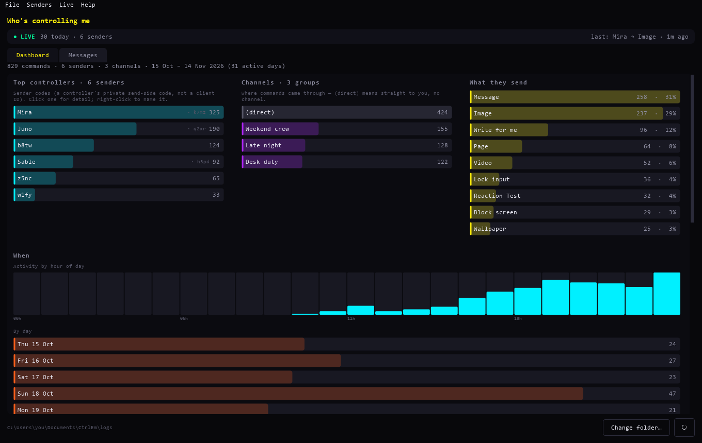
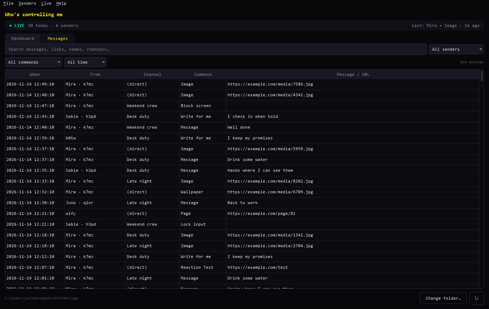

# Tetherware

*They hold the leash. You read the tether.* 18+.

Tetherware is the receiving-side companion for CtrlEm. The CtrlEm receiver
client logs every command you are sent. Tetherware reads those logs and shows
**who's been controlling you**: which senders and channels dominate,
what they send, and when. It also watches today's log live and tells you when
someone starts flooding you.

## What it does

- **Dashboard.** Top controllers, the channels commands came through (or
  *direct*), the command mix, and activity by hour and by day, across all your
  logs.
- **Live watcher.** Follows today's `commands_YYYY-MM-DD.log` as it grows (or
  today's lines in `commands.log`, if CtrlEm is set to one log file). A live
  strip shows today's count and the last command. A tray icon keeps
  watching while the window is minimised, and a toast fires when one sender
  bursts past a threshold you set.
- **Names for senders.** Sender codes are opaque four-character IDs.
  Right-click one to give it a name you'll recognise. Names stay on your
  machine.
- **Per-controller detail.** Click a sender to see their timeline, what they
  send, their channels, and when you first and last heard from them.
- **Message search.** Search everything you were sent, decoded into readable
  text and clean links. Filter by sender, command and date.

## Install and update

Download Tetherware from [vulturif.com](https://vulturif.com/p/tetherware/)
or from this repo's [Releases](https://github.com/Vulturif/Tetherware/releases).
Each one is a single file with no installer: put it anywhere and run it.

- **Windows 10/11:** `Tetherware.exe`.
- **Linux (x86_64):** `Tetherware-x86_64.AppImage`. Make it executable
  (`chmod +x Tetherware-x86_64.AppImage`) and run it. It needs glibc 2.35 or
  newer: Ubuntu 22.04+, Debian 12+, Fedora 35+.

On Windows, Tetherware can check for a new version when it starts (**Help →
Check for updates at startup**, on by default), or whenever you choose **Help
→ Check for updates now**. Every update is signed, and Tetherware checks the
signature before it replaces itself. You can skip a version you don't want.
On Linux it doesn't update itself yet: download the new AppImage and replace
the old one.

## Where the logs are

Tetherware works with both ways the CtrlEm receiver client can log:

- **One file per day** (`commands_YYYY-MM-DD.log`), the default.
- **One file** (`commands.log`), if the client is set to a single log.

Tetherware first looks for a `CtrlEm\logs` folder in your AppData and home
folders (on Linux: `~/.config`, `~/.local/share` and home). If your receiver client writes its logs somewhere else, use
**Change folder…** at the bottom of the window. Tetherware remembers the
folder you pick.

## Privacy

- Tetherware only **reads** the receiver client's log files. It never changes
  them and never contacts CtrlEm.
- Your logs, sender names and messages never leave your machine.
- **Usage stats are opt-in and off by default.** Tetherware asks once. If you
  say yes, it counts which features get used (for example "watcher started"),
  never anything from your logs. Turn it off any time under **Help → Usage
  statistics**.
- **Help → Send feedback…** sends what you type, the app and operating-system
  version, and recent error details only if you tick that box. It sends nothing from
  your logs, and only when you press send.

## Part of the Vulturif family

Tetherware shares the [vulturif-kit](https://github.com/Vulturif/vulturif-kit)
machinery with the other Vulturif apps: signed self-update, opt-in stats,
feedback and supporter keys. Like them, it is distributed through
[vulturif.com](https://vulturif.com/). It is the mirror image of
[Leashware](https://vulturif.com/p/leashware/): Leashware sends commands,
Tetherware shows what came back to you. The two share no code.

A supporter key unlocks early access to new versions and works across all the
Vulturif apps. Nothing is switched off when a key lapses; you simply get the
public releases again.
